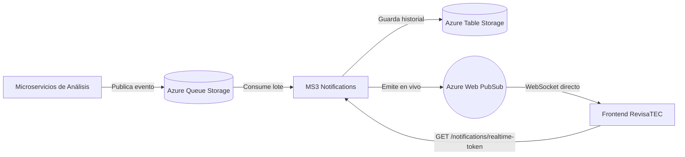

# RevisaTEC — MS3: Notifications & Realtime

Microservicio de notificaciones asíncronas y eventos en tiempo real para la plataforma **RevisaTEC**.

Consume eventos publicados por los microservicios de análisis (`ms-analysis`), asegura idempotencia, persiste el historial en **Azure Table Storage**, emite eventos en vivo hacia el frontend a través de **Azure Web PubSub** y ofrece una API REST para consulta y gestión del estado de lectura.

---

## 🏗 Arquitectura



1. **Ingesta de Eventos:** Los eventos (`FEEDBACK_PUBLISHED`, `ISSUE_DETECTED`) llegan a la cola principal `notificaciones` en **Azure Queue Storage**.
2. **Consumo e Idempotencia:** El worker (`QueueConsumer`) procesa los mensajes por lotes, valida el esquema (`messageSchema.js`) y almacena el evento en Azure Table Storage usando el `eventId` como clave única (RowKey) bajo la partición `professor`. Si el evento ya existía, se detecta el conflicto 409 y se descarta de forma segura sin duplicar registros.
3. **Manejo de Mensajes Inválidos y Poison:** Los mensajes corruptos o que superan `MAX_DEQUEUE_COUNT` reintentos son archivados en la cola `notificaciones-poison` con el detalle del error y eliminados de la cola principal.
4. **Tiempo Real con Azure Web PubSub:** Al persistir una nueva notificación, MS3 emite el evento mediante `WebPubSubPublisher` a todos los clientes conectados al Hub `notifications`.
   - El cliente solicita un token temporal en `GET /notifications/realtime-token`.
   - El navegador abre un **WebSocket nativo directo a Azure Web PubSub** con esa URL.
   - Si el servicio de tiempo real no está configurado, MS3 opera normalmente con `NoopPublisher` y responde 503 en el endpoint del token.
5. **API REST:** Endpoints en Express para que el frontend consulte el historial paginado y gestione el estado de lectura.

---

## 🔐 Seguridad y Acceso

- El servicio se publica únicamente a través de **Azure API Management (APIM)**. APIM presenta un certificado de cliente (mTLS) y el App Service rechaza las llamadas directas que no lo traigan.
- Los consumidores envían el header `Ocp-Apim-Subscription-Key` hacia APIM. La clave nunca se guarda en este repositorio.
- Única excepción: la conexión **WebSocket** del navegador va directa a Azure Web PubSub, con un token temporal que se obtiene por `GET /notifications/realtime-token` (esa petición sí pasa por APIM).
- `CORS_ALLOWED_ORIGINS` es solo para desarrollo local; en Azure se deja vacío y CORS se configura en APIM.

---

## 📡 Formato del Mensaje de Tiempo Real

Los mensajes transmitidos a los clientes suscritos al WebSocket tienen la siguiente estructura JSON:

```json
{
  "event": "notification.created",
  "data": {
    "id": "7f3b1c9e-2d4a-4c1e-9a55-0f6a8b2d1e33",
    "type": "FEEDBACK_PUBLISHED",
    "title": "Retroalimentación publicada",
    "message": "Se publicó la retroalimentación del Grupo A",
    "courseId": 1,
    "groupId": 1,
    "createdAt": 1792000000000,
    "read": false,
    "source": "ms-analysis"
  }
}
```

Las fechas (`createdAt`) son Epoch en milisegundos; el frontend las convierte a la zona horaria del dispositivo.

---

## ⚙ Variables de Entorno

Configura un archivo `.env` en la raíz (puedes basarte en `.env.example`):

| Variable | Descripción | Valor por Defecto |
|---|---|---|
| `PORT` | Puerto HTTP donde escucha Express | `3000` |
| `QUEUE_CONNECTION_STRING` | Cadena de conexión de Azure Storage *(requerida)* | — |
| `QUEUE_NAME` | Nombre de la cola de eventos entrantes | `notificaciones` |
| `POISON_QUEUE_NAME` | Nombre de la cola de descarte para mensajes inválidos | `notificaciones-poison` |
| `TABLE_NAME` | Nombre de la tabla en Azure Table Storage para el historial | `notificaciones` |
| `POLL_INTERVAL_MS` | Intervalo base de sondeo de la cola en milisegundos | `3000` |
| `VISIBILITY_TIMEOUT_S` | Tiempo de visibilidad del mensaje en segundos | `30` |
| `MAX_DEQUEUE_COUNT` | Número máximo de reintentos antes de mover a poison | `5` |
| `REALTIME_CONNECTION_STRING` | Cadena de conexión de Azure Web PubSub *(opcional; si falta usa NoopPublisher)* | `""` |
| `REALTIME_HUB` | Nombre del hub de Web PubSub | `notifications` |
| `REALTIME_TOKEN_TTL_MINUTES` | Minutos de validez para el token temporal generado al frontend | `60` |
| `CORS_ALLOWED_ORIGINS` | Orígenes permitidos separados por coma *(SOLO desarrollo local)* | `""` |

> 🔒 **Seguridad:** El archivo `.env` está en `.gitignore` y **nunca** debe subirse al repositorio ni incluir credenciales en logs o commits.

---

## 🚀 Comandos de Ejecución

Requiere Node.js 22 o superior.

```bash
# Instalar dependencias
npm install

# Ejecutar todas las pruebas automáticas (29 tests pasando sin dependencias de Azure)
npm test

# Iniciar en modo desarrollo con recarga automática
npm run dev

# Iniciar en modo producción
npm start

# Enviar mensaje de prueba a la cola de Azure
npm run send:test

# Enviar un mensaje de otro tipo y grupo (tipo y número de grupo)
npm run send:test -- ISSUE_DETECTED 2

# Enviar el mismo mensaje dos veces (prueba de idempotencia)
npm run send:test -- --duplicate

# Enviar un mensaje con estructura inválida (termina en la cola poison)
npm run send:test -- --invalid

# Escuchar eventos en vivo desde Azure Web PubSub (WebSocket)
npm run listen:test
```

---

## 🧪 Verificación de Punta a Punta en Desarrollo Local

Para probar todo el flujo de tiempo real de forma local:

1. **Terminal 1 (Servidor MS3):**
   ```bash
   npm run dev
   ```
2. **Terminal 2 (Cliente escucha en tiempo real):**
   ```bash
   npm run listen:test
   ```
   *(Verás el mensaje de conexión exitosa a Azure Web PubSub).*
3. **Terminal 3 (Productor de eventos):**
   ```bash
   npm run send:test
   ```
   *El evento llegará a la Terminal 2 en tiempo real (menos de 2 segundos) y quedará persistido en Table Storage.*

---

## 🧪 Pruebas de API (Postman)

La carpeta `postman/` contiene la colección y el entorno local, con una prueba por endpoint (incluye los casos 400 y 404). Con el servidor en marcha (`npm run dev`) y al menos un mensaje enviado (`npm run send:test`):

```bash
npx newman run postman/revisatec-ms3.postman_collection.json -e postman/ms3-local.postman_environment.json
```

La clave de APIM (`apimKey`) se define en el entorno de Postman y nunca se guarda en el repositorio.

---

## 📡 Endpoints REST

| Método | Ruta | Descripción |
|---|---|---|
| `GET` | `/health` | Diagnóstico de salud base (inmutable para APIM y balanceadores) |
| `GET` | `/health/dependencies` | Estado de conectividad con la cola de Azure Storage |
| `GET` | `/notifications/realtime-token` | URL con token temporal de conexión a Web PubSub (Cache-Control: no-store) |
| `GET` | `/notifications` | Lista de notificaciones con paginación (`page`, `pageSize`) y filtro (`search`, sobre título, mensaje o tipo) |
| `PATCH` | `/notifications/:id/read` | Marca una notificación específica como leída (`read: true`) |
| `PATCH` | `/notifications/read-all` | Marca todas las notificaciones pendientes como leídas |

**Formato de la lista:** `GET /notifications` responde `{ page, pageSize, totalRecords, totalPages, unreadCount, data }`. La lista viaja en `data` (MS1 y MS2 usan `items`). Los errores usan `{ "error": "mensaje" }`.

Consulta la especificación OpenAPI en [openapi.yaml](openapi.yaml).

---

## ☁ Despliegue

Al hacer push a `main`, GitHub Actions (`.github/workflows/ci-cd.yml`) instala dependencias, ejecuta lint, build y pruebas, y despliega a **Azure App Service**. El workflow usa el secret `AZURE_WEBAPP_PUBLISH_PROFILE` y la versión de Node definida en `NODE_VERSION` del propio archivo.

En el App Service se configuran como *Application settings* las variables de la tabla anterior (mínimo `QUEUE_CONNECTION_STRING`; para tiempo real, `REALTIME_CONNECTION_STRING`). El servicio arranca con `npm start`. Nunca se suben secretos al repositorio.
